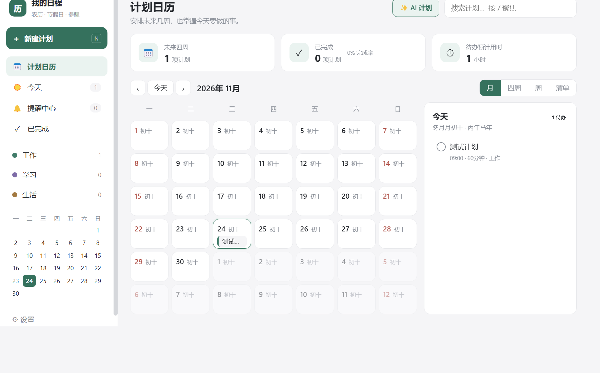
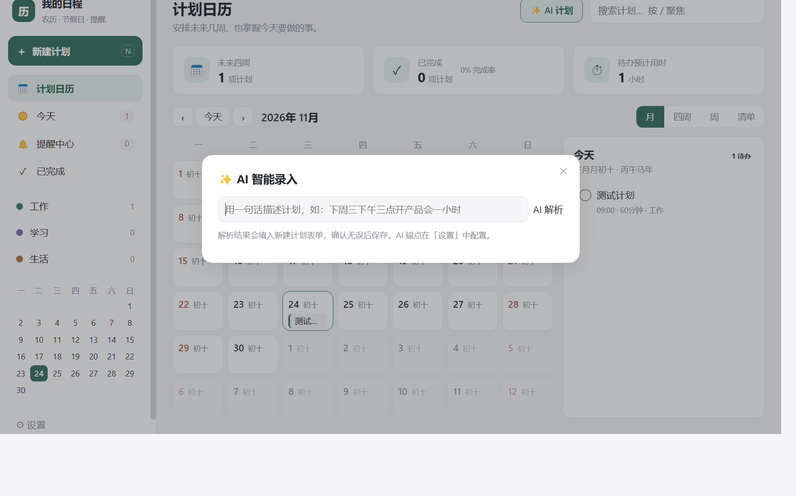
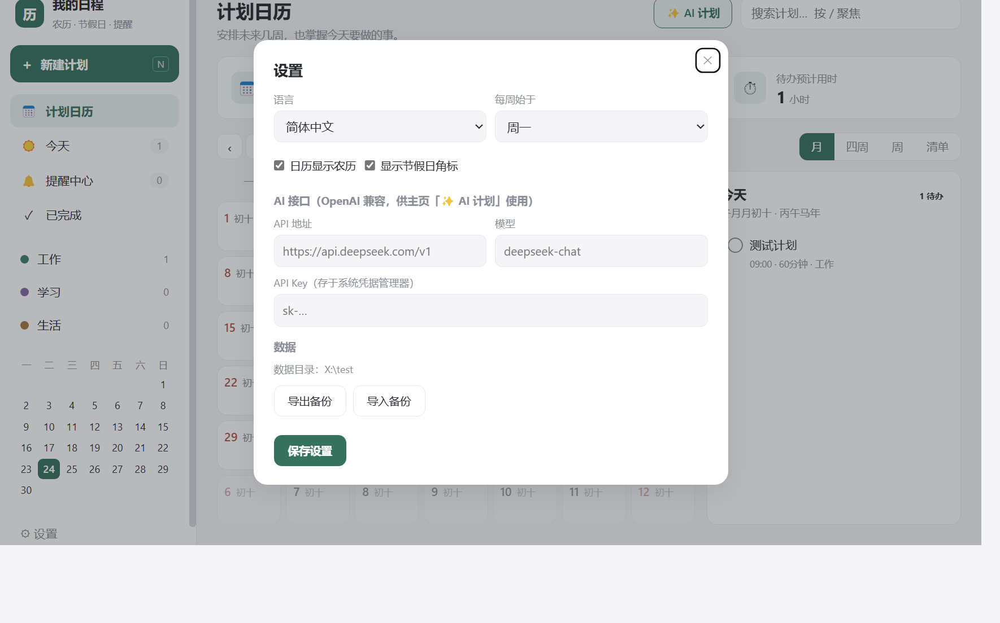

<p align="center"><a href="README.md">简体中文</a> · <strong>English</strong></p>

# My Schedule (my-schedule)

[](LICENSE)
[](https://go.dev/)
[](#usage)

A native Windows desktop schedule app: Go core + WebView2 shell (plan C+D, see
`docs/architecture.md` — Chinese). No Electron, no external services, no CDN
dependencies; all data stays in a local SQLite database and nothing is uploaded.



The data model and business rules are partly derived from
[orange-schedule](https://github.com/OrangeCatzhang/orange-schedule) (MIT).

## Features

- **Four views**: Month / Four weeks / Week / List (today, inbox, completed)
- **Plan management**: multi-day plans, duration, categories (work/study/life), priority, notes
- **Recurring plans**: 1/4/8/12 times per week, or daily/workdays until an end date; series actions ("only this" / "this and following") guarded by an anti-drift token
- **Reminders**: 0–1440 minutes lead time; Windows system notifications + in-app reminder overlay; 10-minute snooze
- **Lunar calendar & holidays**: lunar/Ganzhi/zodiac/solar terms, Chinese statutory holidays and make-up workdays (built-in 2025–2027 data), US federal holidays
- **AI parsing**: natural language to plan drafts (any OpenAI-compatible endpoint; the API key is stored only in Windows Credential Manager, never on disk)
- **Backup**: JSON export/import (compatible with orange-schedule format)
- **Lightweight**: ~30MB RAM for the Go process, zero idle polling (single-timer scheduling), <1s cold start (excluding first-time WebView2 initialization)

| AI capture | Settings |
| :---: | :---: |
|  |  |

## Build

Requires Go 1.26+ and the WebView2 runtime (bundled with Windows 10/11).

```powershell
go build -ldflags "-s -w" -o build\myschedule.exe .\cmd\myschedule
```

Put intermediate artifacts into `temp/` (gitignored); release builds go to `build/`.

## Usage

```powershell
.\build\myschedule.exe                 # normal start (data in %AppData%\MySchedule)
.\build\myschedule.exe --selftest      # core pipeline self-test
.\build\myschedule.exe --eval "plans.list {}"   # call any command from the CLI
```

The environment variable `MY_SCHEDULE_DATA` overrides the data directory (for development).

## Command API

Every feature is exposed as a `module.method(params)` command (frontend JS, CLI
`--eval`, and a future MCP server all share the same registry path); full
signatures in `docs/module-api.md` (Chinese):

- `plans.*`: list / get / save / toggle / delete / move / stats / due / snooze / previewAction / applyAction
- `holidays.*`: day / cn / us
- `settings.*`: get / set
- `backup.*`: export / import
- `ai.*`: parse
- `app.*`: info / testReminder / quit

## Project layout

```
cmd/myschedule/    entry point (flag parsing, selftest, --eval)
internal/
  model/           data model (Task/Settings/History)
  dates/           pure date helpers
  storage/         SQLite persistence (modernc.org/sqlite, pure Go, no CGO)
  plans/           plan domain service (validation/CRUD/recurrence/series/reminders)
  holidays/        lunar calendar & holidays
  scheduler/       single-timer reminder scheduling
  registry/        command registry (exportable to MCP)
  ai/              OpenAI-compatible client
  app/             app assembly (WebView2 window, bridge, command wiring, notifications)
web/               frontend (no framework, no CDN, embedded via go:embed)
docs/              architecture / module API / dev process / coding standards (Chinese)
```

## Development

- Dev process: `docs/development-process.md` (milestones M0–M5, commit rules)
- Coding standards: `docs/coding-standards.md` (dependency whitelist, zero polling, safety rules)
- Architecture decisions: `docs/architecture.md`

```powershell
go vet ./...
go test ./...
```

## Roadmap

System tray mode, MCP server, i18n (English UI), cloud sync. See `docs/architecture.md`.

## License

[MIT](LICENSE) © 2026 wangyunpeng12138 and project contributors.

## Acknowledgements

- [orange-schedule](https://github.com/OrangeCatzhang/orange-schedule)
  (MIT License, Copyright (c) OrangeCatzhang and Weeklight contributors):
  the data model and business rules of this project are partly derived from it.