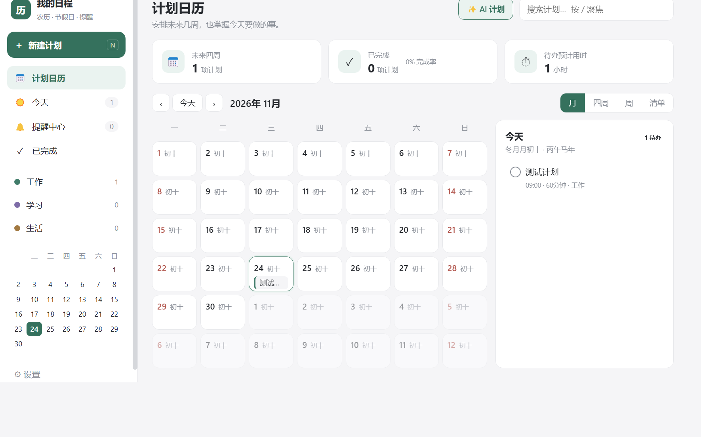
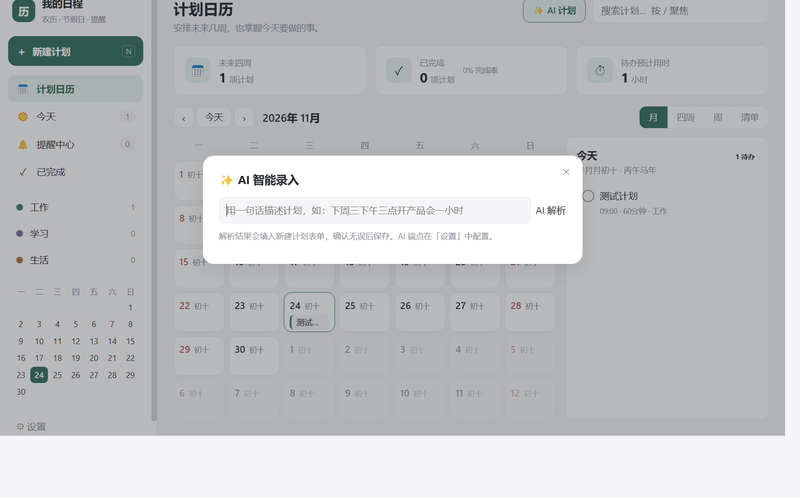
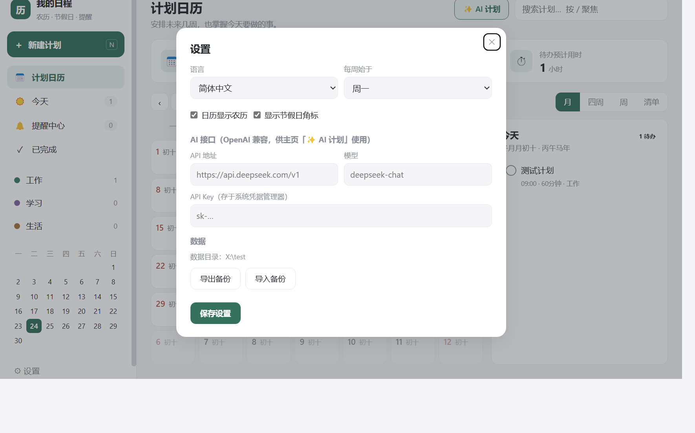

<p align="center"><strong>简体中文</strong> · <a href="README.en.md">English</a></p>

# 我的日程（my-schedule）

[](LICENSE)
[](https://go.dev/)
[](#运行)

原生 Windows 桌面日程应用：Go 核心 + WebView2 壳（方案 C+D，见 `docs/architecture.md`）。
无 Electron、无外置服务、无 CDN 依赖；数据全部保存在本地 SQLite，不上传任何信息。



数据模型与业务规则参考并部分衍生自 [橙子日程](https://github.com/OrangeCatzhang/orange-schedule)（MIT）。

## 特性

- **四种视图**：月历 / 四周 / 周 / 清单（今日、收件箱、已完成）
- **计划管理**：跨天计划、时长、分类（工作/学习/生活）、优先级、备注
- **重复计划**：每周 1/4/8/12 次，或每天/工作日至截止日；系列操作（仅此条 / 后续全部）带 token 防漂移
- **提醒**：提前 0–1440 分钟可选；Windows 系统通知 + 应用内提醒浮层；贪睡 10 分钟
- **农历与节假日**：农历/干支/生肖/节气、中国法定节假日与调休补班（2025–2027 内置数据）、美国联邦假日
- **AI 解析**：自然语言转计划草稿（任意 OpenAI 兼容端点；API Key 只存 Windows 凭据管理器，不落盘）
- **备份**：导出/导入 JSON（与橙子日程格式兼容）
- **轻量**：Go 进程约 30MB 内存，空闲零轮询（单定时器调度），冷启动 < 1 秒（不含 WebView2 首次初始化）

| AI 智能录入 | 设置 |
| :---: | :---: |
|  |  |

## 构建

需要 Go 1.26+ 和 WebView2 运行时（Windows 10/11 自带）。

```powershell
go build -ldflags "-s -w" -o build\myschedule.exe .\cmd\myschedule
```

中间产物请放入 `temp/`（已 gitignore）；正式发布输出到 `build/`。

## 运行

```powershell
.\build\myschedule.exe                 # 正常启动（数据存 %AppData%\MySchedule）
.\build\myschedule.exe --selftest      # 核心链路自检
.\build\myschedule.exe --eval "plans.list {}"   # 命令行直调任意命令
```

环境变量 `MY_SCHEDULE_DATA` 可覆盖数据目录（开发调试用）。

## 命令 API

全部功能通过 `module.method(params)` 命令暴露（前端 JS、CLI `--eval`、
未来的 MCP 服务器走同一条注册表路径），完整签名见 `docs/module-api.md`：

- `plans.*`：list / get / save / toggle / delete / move / stats / due / snooze / previewAction / applyAction
- `holidays.*`：day / cn / us
- `settings.*`：get / set
- `backup.*`：export / import
- `ai.*`：parse
- `app.*`：info / testReminder / quit

## 项目结构

```
cmd/myschedule/    入口（flag 解析、selftest、--eval）
internal/
  model/           数据模型（Task/Settings/History）
  dates/           纯日期函数
  storage/         SQLite 持久化（modernc.org/sqlite，纯 Go，无 CGO）
  plans/           计划领域服务（校验/CRUD/重复/系列/提醒判定）
  holidays/        农历与节假日
  scheduler/       单定时器提醒调度
  registry/        命令注册表（MCP 可导出）
  ai/              OpenAI 兼容客户端
  app/             应用装配（WebView2 窗口、桥接、命令注册、通知）
web/               前端（无框架、无 CDN，go:embed 嵌入）
docs/              架构 / 模块 API / 开发流程 / 编码规范
```

## 开发

- 开发流程：`docs/development-process.md`（里程碑 M0–M5、提交规范）
- 编码规范：`docs/coding-standards.md`（依赖白名单、零轮询、安全规则）
- 架构决策：`docs/architecture.md`

```powershell
go vet ./...
go test ./...
```

## 路线图

系统托盘常驻、MCP 服务器、多语言（en）、云同步。见 `docs/architecture.md`。

## 许可

[MIT](LICENSE) © 2026 wangyunpeng12138 及本项目贡献者。

## 致谢

- [橙子日程（orange-schedule）](https://github.com/OrangeCatzhang/orange-schedule)
  （MIT License，Copyright (c) OrangeCatzhang and Weeklight contributors）：
  本项目的数据模型与业务规则参考并部分衍生自该项目，特此致谢。